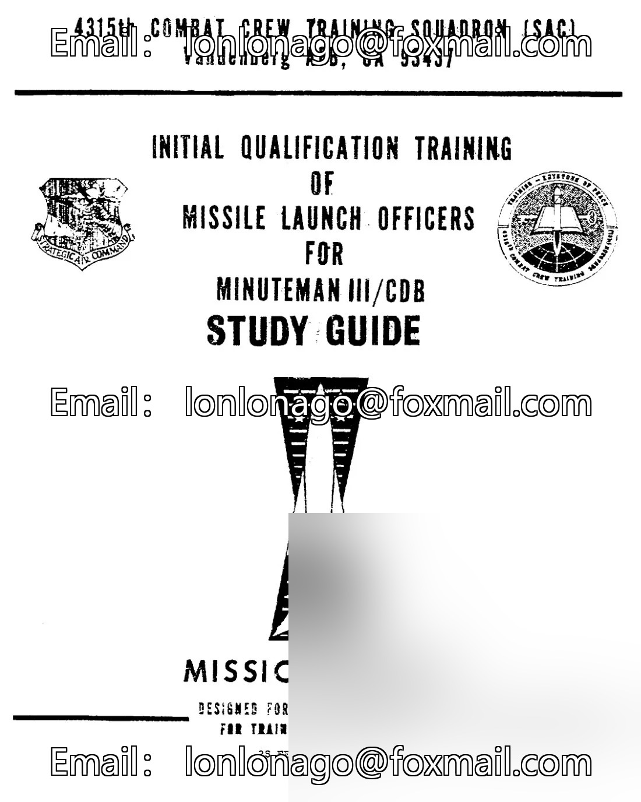
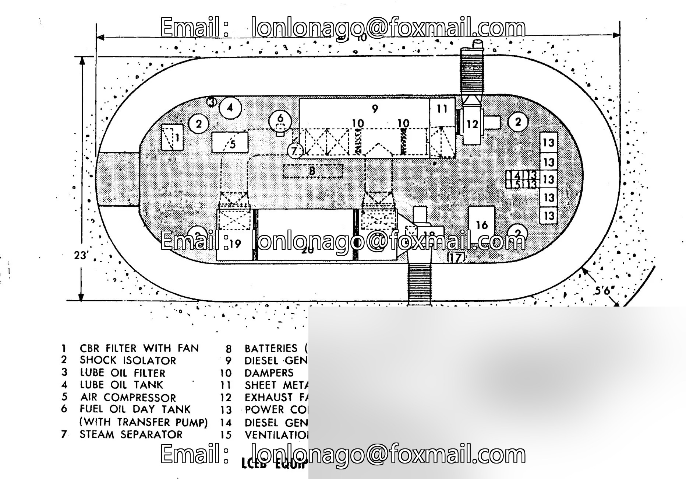
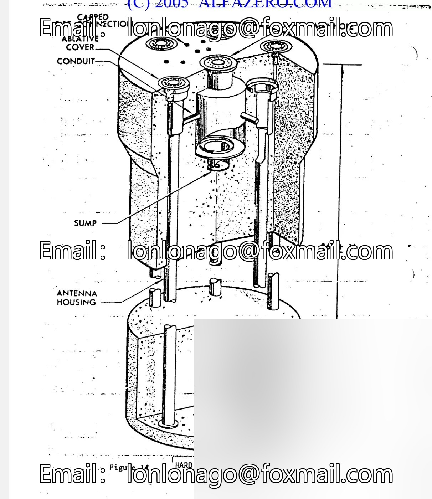
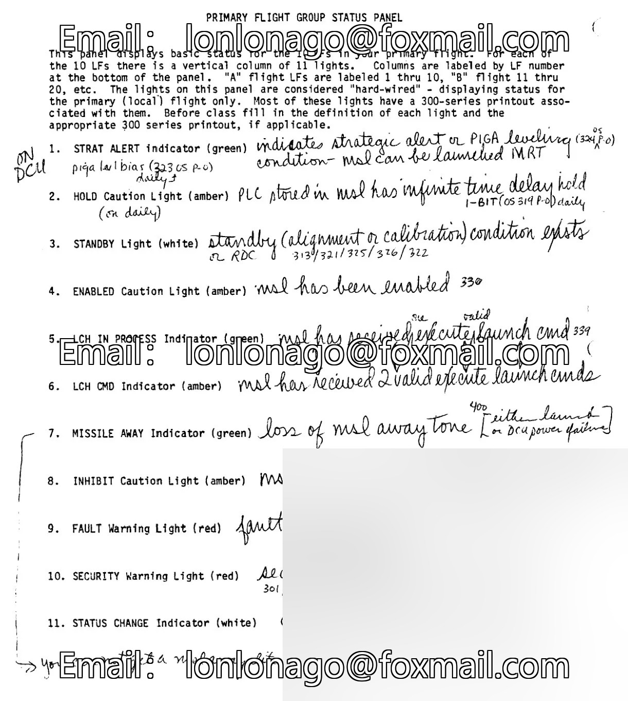
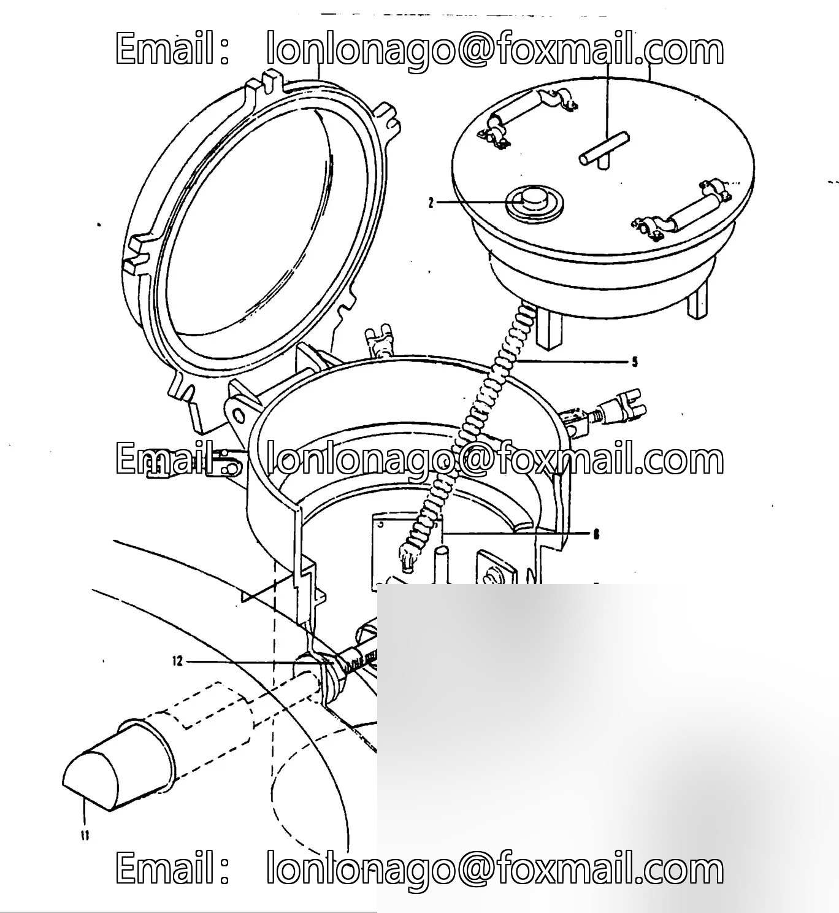

# U.S. Air Force "Mechanized III/CDB Missile Launch Officer" Initial Qualification Training Specific

## Body

The initial qualification training book for U.S. Air Force "Marlin III/CDB missile launch officer", version 25 February 1983.
1. Analysis of the materials system
1. Material nature
Official training book, written by 4315th COMBAT CREW TRAINING SQUADRON (SAC), suitable for initial qualification training of missile launch officers.
2. Content characteristics
Core content:
Overview of missile launch control system principles
Layout and function of launch facilities and equipment
Safety operating procedures
Fault diagnosis and resolution
Technical background:
Training materials for strategic weapon system in the Cold War
Focuses on explaining content such as missile launch control panels, equipment layout, and safety procedures.
3. Usage scope

Available for 1QT course use only
For training purposes only
are copyable; upon sale.

This is a special training textbook for U.S. Air Force's Minis tri/CDB missile launch officers' initial qualification training, written by 4315th COMBAT CREW TRAINING SQUADRON (SAC), covering missile launch control principles, launch facility layout, safety procedures, fault diagnosis and other content, along with Cold War strategic weapon system training and specific panel functional details.

<!-- AI_ENRICHED -->

## Images

## Payment

Here is a pay link on Stripe ( https://buy.stripe.com/3cs8yP7sY87d0vu9AB ). Please contact me lonlonago@foxmail.com after funding $89, and I will send you a complete data files , thank you!

